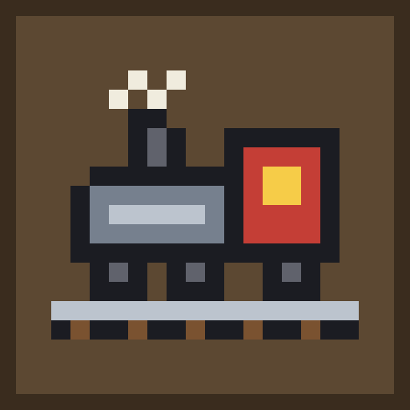

# Railhold

NeoForge mod: trains of minecarts with chain links, locomotives and storage minecarts.

## State

The rails stay vanilla. The player links minecarts with a chain to make a train:

- **Chain links**: a chain links two minecarts. The train moves as one unit, and the minecarts do not push each other.
- **Furnace locomotive** and **heavy locomotive**: they pull the train with a force, a mass and a fuel. The heavy locomotive is faster and burns blocks of coal. The action bar shows the fuel.
- **Storage minecarts**: the double chest minecart (54 slots), the shulker box minecart (keeps its items when it breaks) and the ender chest minecart.
- **Speed**: a train slows down before a curve or a slope, so that it does not leave the rails.
- **Chunk loading** (option, off by default): a locomotive that moves loads the chunks of its train and the chunks in front of it. It burns more fuel.

The mod needs no other mod. The rules and the configuration are in [docs/design.md](docs/design.md).

## Worlds of Folkhold Balance

A world of Folkhold Balance opens with Railhold and keeps its trains, its locomotives and its storage minecarts. Railhold reads the ids `folkhold_balance:*` of the items, the entities and the chain links. The config file has a new name (`railhold-server.toml`). To keep changed values, copy the section `[rails]` to the new file. The details are in [docs/design.md](docs/design.md#worlds-of-folkhold-balance).

## Contribute

Read [CONTRIBUTING.md](CONTRIBUTING.md) for the workflow, the build, the tests and the versions.

## License

[MIT](LICENSE)

## State

The rails stay vanilla. The player links minecarts with a chain to make a train:

- **Chain links**: a chain links two minecarts. The train moves as one unit, and the minecarts do not push each other.
- **Furnace locomotive** and **heavy locomotive**: they pull the train with a force, a mass and a fuel. The heavy locomotive is faster and burns blocks of coal. The action bar shows the fuel.
- **Storage minecarts**: the double chest minecart (54 slots), the shulker box minecart (keeps its items when it breaks) and the ender chest minecart.
- **Speed**: a train slows down before a curve or a slope, so that it does not leave the rails.
- **Chunk loading** (option, off by default): a locomotive that moves loads the chunks of its train and the chunks in front of it. It burns more fuel.

The mod needs no other mod. The rules and the configuration are in [docs/design.md](docs/design.md).

## Worlds of Folkhold Balance

A world of Folkhold Balance opens with Railhold and keeps its trains, its locomotives and its storage minecarts. Railhold reads the ids `folkhold_balance:*` of the items, the entities and the chain links. The config file has a new name (`railhold-server.toml`). To keep changed values, copy the section `[rails]` to the new file. The details are in [docs/design.md](docs/design.md#worlds-of-folkhold-balance).

## Contribute

Read [CONTRIBUTING.md](CONTRIBUTING.md) for the workflow, the build, the tests and the versions.

## License

[MIT](LICENSE)
